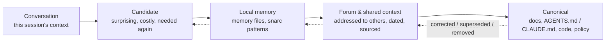

# Persistent Agent Workspace

An agent session can end, compact, or move to a different model. The work doesn't have to disappear.

This guide sets up continuity *outside* the session: instruction files, memory, git repos, a forum, and a working habit. With that in place, a new session, a different model or a rebooted machine can reconstruct where the work stands.

- **Part I** is the core and takes about 45 minutes. Most of the value is there.
- **Part II** adds extensions, each preserving a different kind of thing.

### Why the examples use Claude Code

Claude Code was the first local agentic CLI this workspace adopted, and it is still its most active participant, so it is the best-exercised setup and the one Part I uses for copy-and-run commands. The architecture itself isn't Claude-specific.

> **Portability.** Our fleet also runs OpenAI Codex, Kimi, Gemini, and local models through SAGE. They all work through the same Git repos, shared docs and forum. What differs between them is the plumbing: instruction filenames, memory, hooks, permissions and CLI flags. The rule we follow is:
>
> **Commit facts and handoffs in shared formats. Keep CLI flags, user-level memory and hooks in harness-specific adapters.**
>
> Where a command below is Claude Code-only, the section says so. For other harnesses, use their documented equivalent and verify it (section 09). A file existing is not proof an agent loaded it.

Commands are given for **Windows (WSL)**, **Linux** and **macOS** where they differ. Dependencies, model tags, releases and CLI behavior change; each project's own README and `docs/` take precedence over this file. A command that runs without error is not proof the workflow works, so use the verification steps in sections 09 and 15.

> **Status: tested by components, not yet reproduced end to end.** Commands and repository sources were reviewed in October 2026, and the components run in our fleet, but nobody outside it has yet completed the core on a clean machine. If you try, a precise failure report is as useful to us as a success.

## Contents

**Part I · Core (about 45 minutes)**

- [00 The idea](#00-the-idea): what outlasts a session
- [01 Start with a conversational assistant](#01-start-with-a-conversational-assistant)
- [02 Install a local agent CLI: Claude Code example](#02-install-a-local-agent-cli-claude-code-example)
- [03 Using the CLI](#03-using-the-cli)
- [04 Onboard your agent](#04-onboard-your-agent): a sample primer
- [05 Instructions & memory across tools](#05-instructions--memory-across-tools)
- [06 Workspace & repos](#06-workspace--repos)
- [07 The forum](#07-the-forum)
- [08 How knowledge moves](#08-how-knowledge-moves): promotion, and when sources disagree
- [09 The session habit](#09-the-session-habit): WAKE · FOCUS · so what?, and verifying the core

**Part II · Extensions: different kinds of continuity**

- [10 snarc](#10-snarc): salience
- [11 membot](#11-membot): retrievable meaning
- [12 hestia](#12-hestia): accountable action (early prototype)
- [13 SAGE](#13-sage): an actor across time (research-stage)
- [14 More than one machine](#14-more-than-one-machine) (advanced)
- [15 Extension checklist](#15-extension-checklist)

---

# Part I · Core: a workspace that outlasts its sessions

An agentic CLI, instruction files, memory, git, a forum, and a habit. Stop at the end of this part and you already have the important architecture. With just these, you can reproduce most of what makes our setup work.

## 00 The idea

Nothing here makes a session remember. Sessions are disposable: they end, get compacted, crash, or run on a different model next month. Continuity comes from pushing the state that matters *out* of the session into places that outlast it. Each place keeps a different kind of state:

| Layer | Preserves |
|---|---|
| Instruction & memory files | **declared state**: how to work, what the project is, what was learned |
| Git repos | **shared history**: what changed, when, by whom, and why |
| The forum | **reasoning and handoffs**: findings, measurements, open questions, reviews |
| *Part II ·* snarc | **salience**: what was surprising or costly, scored as it happens |
| *Part II ·* membot | **retrievable meaning**: passages found by what they're about |
| *Part II ·* hestia | **accountable action**: what covered agents did, and what they were refused |
| *Part II ·* SAGE | **an actor across time**: a local model with an identity that persists |

A new session consults the first three to rebuild enough of the picture to continue. Instruction files load automatically where the harness supports it; the forum is read only because you instruct the session to read it (section 07). That's the architecture: the model and the session are replaceable, and the work survives because its state was deliberately put somewhere inspectable.

### Autonomy and accountability

The layers give agents durable instructions, memory, room for initiative, and increasingly independent execution. Hestia (section 12) then adds law and accountability. These are not opposing forces to trade off. The purpose of law in the loop isn't to make an agent passive; it's to let it act with more freedom inside boundaries that are explicit, inspectable and contestable. That's the design aim. Section 12 is candid about how much of it the current prototype delivers.

### What this does and doesn't claim

There are four distinct milestones, and success at one is not proof of the next:

1. **Project continuity:** the work can be reconstructed from files and history. Part I gets you here.
2. **Operational continuity:** state and scheduled tasks survive restarts. Sections 11–14 work toward this.
3. **Maintained agent identity:** an identity is explicitly represented and recognized across episodes. SAGE (section 13) is the research on this.
4. **Subjective continuity:** not established by any of these mechanisms alone.

### Words you'll meet

| Term | Meaning here |
|---|---|
| Session | One bounded agent interaction, e.g. one Claude Code, Codex, Kimi, Gemini or local-agent run. What survives between sessions varies by tool, which is why this guide keeps important state outside them. |
| Context | What an agent can see in the current session: conversation, loaded instructions, tool results, files it read. Limited in size; long sessions get summarised ("compacted"). |
| `CLAUDE.md` / `AGENTS.md` | Markdown files of standing instructions an agent reads at session start. Which filename is read, and in what order, depends on the harness. |
| Memory | Persistent notes some harnesses keep between sessions. Whether they exist and load automatically depends on the tool. |
| Repo | A git repository: a folder whose history is tracked and can be shared (e.g. on GitHub). |
| Hook | A script the harness runs automatically at a moment, e.g. after every tool call. Supported events and failure behavior differ by harness. snarc and hestia work through hooks. |
| MCP server | A program that gives an agent extra tools ("Model Context Protocol"). membot and snarc are MCP servers. |
| Daemon / service | A program that keeps running in the background, started by the OS (systemd on Linux, launchd on macOS). |
| Being | In SAGE: a local model given a persistent identity, memory and a schedule, so it acts over days rather than one chat. |
| Fleet | Our name for a group of machines, each running its own agents, that coordinate through shared repos. You don't need one; see section 14. |

---

## 01 Start with a conversational assistant

If you already talk with an AI assistant (Claude, ChatGPT, Gemini, or another), use that conversation to get set up. A browser conversation without connected local tools can't change your computer, and some desktop apps can, depending on setup and permissions. Either way, it can walk you through each step, read the errors you paste back, and help draft your onboarding primer.

1. **Ask the app to guide the install.** Something like:

   ```text
   I want to install Claude Code on my [Windows / Mac / Linux] computer and I'm not
   very familiar with the terminal. Walk me through it one step at a time. Wait for me
   to paste the result of each step before giving the next one.
   ```

   Paste this guide into the chat too, so it follows the same steps.

2. **Paste errors in full.** Copy the whole terminal output, not a summary. Most install problems are recognisable from the exact message.

3. **Have the app draft your onboarding primer.** Depending on its memory settings, the assistant may know a lot about what you've been discussing. Before you switch, ask:

   ```text
   I'm about to start using Claude Code on this project. Using what you know from our
   conversations, fill in this onboarding primer for it: [paste the primer from section 04].
   Keep it short and specific. Leave anything you don't know as a question for me.
   ```

4. **Then switch to the CLI** for the actual work, and paste the primer as your first message (section 04). From then on, continuity lives in the files that session writes, and every later session rebuilds its picture of the work from them.

> **An assistant's memory does not carry into a local CLI.** Treat app conversations and CLI sessions as separate unless you've demonstrated a specific integration. The primer carries over what you choose to transfer.

---

## 02 Install a local agent CLI: Claude Code example

- **Needs:** a paid Claude plan that includes Claude Code (Pro or higher) or a Console API account; the free plan doesn't include it. See the [official setup page](https://code.claude.com/docs/en/setup) for current plans and requirements. 4 GB+ RAM.
- **OS:**
  - Windows 10 1809+ (native or WSL 2);
  - Ubuntu 20.04+ / Debian 10+;
  - macOS 13+.
- **Verify:** `claude --version` and `claude doctor`.

### Windows (WSL)

Everything later in this guide (hooks, daemons, systemd services) assumes a Linux shell, so on Windows install Ubuntu under WSL and do all your work there.

1. Open PowerShell or Command Prompt and install Ubuntu:

   ```powershell
   wsl.exe --install Ubuntu
   ```

2. Create your Linux account when prompted. **Typing the password shows nothing, not even asterisks.** Type it, press Enter, then do the same to confirm.

3. In the Ubuntu window, install Claude Code with the native installer:

   ```bash
   cd ~
   curl -fsSL https://claude.ai/install.sh | bash
   claude
   ```

4. Pick the **Claude account with subscription** login, not the API option. If the browser doesn't open by itself, Ctrl-click the link, sign in to your Claude account, and paste the code it shows back into the Ubuntu window.

5. Later, open a WSL shell from any Command Prompt with `wsl`.

> **Keep your work on the Linux side.** `/mnt/c/...` works, but it's slow for large repos. The Windows mount also misreports file permissions (executable bits in particular), which can quietly break scripts and hooks. Put your workspace in your Linux home, e.g. `~/ai-workspace`. From Windows Explorer it's at `\\wsl$\Ubuntu\home\<you>`.

Hestia, membot and SAGE run as `systemd` user services. Recent Ubuntu on WSL enables systemd by default. Check with `cat /etc/wsl.conf`, which should contain:

```ini
[boot]
systemd=true
```

and `systemctl --user status`, which should report a running user manager. If those lines are missing, add them to `/etc/wsl.conf` (with `sudo`), then run `wsl --shutdown` from Windows and reopen Ubuntu.

### Linux

```bash
curl -fsSL https://claude.ai/install.sh | bash
claude
```

Debian/Ubuntu, Fedora/RHEL and Alpine can also install from Anthropic's signed apt/dnf/apk repositories (see the official setup docs). The native installer updates itself automatically; package-manager installs don't.

### macOS

```bash
curl -fsSL https://claude.ai/install.sh | bash
# or, with Homebrew (does not auto-update; run brew upgrade claude-code)
brew install --cask claude-code
claude
```

### If you already installed it with npm

Older guides used `nvm install 20` and `npm install -g @anthropic-ai/claude-code`. The npm package still works, but it now requires **Node.js 22+**, and the native installer is the recommended route. Never use `sudo npm install -g`. You'll still want Node for snarc (section 10), so nvm isn't wasted:

```bash
curl -o- https://raw.githubusercontent.com/nvm-sh/nvm/v0.39.7/install.sh | bash
source ~/.bashrc
nvm install 22
```

---

## 03 Using the CLI

*Claude Code only. Other harnesses have their own launch, resume and permission controls; the portable idea is a consistent working directory and external durable state, not identical flags.*

Claude Code works in whichever directory you launch it from. Memory and session history are keyed to that directory too, so pick one launch directory for each kind of work and stick with it.

| Command | What it does |
|---|---|
| `claude` | Start a new session in the current directory. |
| `claude -c` | Continue the most recent session in this directory, with its context intact. |
| `claude --resume` | Pick an earlier session to resume. |
| `claude -p "..."` | One-shot, non-interactive run (scripts, cron, timers). |
| `/init` | Have Claude write a `CLAUDE.md` for the current project. |
| `/memory` | Open and edit the instruction and memory files in use. |
| `/compact` · `/clear` | Summarise the conversation to free context · start fresh. |
| `/model` · `/config` | Switch models · change settings. |
| `/mcp` · `/hooks` | Check connected MCP servers · check installed hooks. |
| `! command` | Run a shell command yourself; its output lands in the conversation. |

### Permissions

By default Claude asks before consequential edits and commands. **Keep those prompts on while you learn and build this setup.** Shift+Tab cycles permission modes during a session; check which mode is active before accepting changes.

There is a `--dangerously-skip-permissions` flag that removes every confirmation. Don't make it your default. Consider it only inside an isolated, disposable VM or container with no valuable credentials, no access to production, and no unrestricted host mounts; git and backups alone are not enough protection. Hestia (section 12) can add a policy gate for supported paths, but it is not a sandbox. See [Claude Code security and permissions](https://code.claude.com/docs/en/permissions).

---

## 04 Onboard your agent

Treat the first session like a new colleague's first day. The agent can read your files, but it doesn't know why the project exists, what you care about, or how you like to work.

1. Fill in the primer below, or have your assistant draft it (section 01).
2. Launch `claude` in your working directory.
3. Paste the primer as the first message.

```markdown
# Onboarding primer

## Who I am
- [Name / role]. [How technical you are: e.g. "comfortable with spreadsheets, new to the terminal".]
- How I like to work: [e.g. "explain what you're about to do before doing anything large"].

## What this is
- This folder is [project]. It exists to [goal, in one or two sentences].
- Where it stands: [what works, what's broken, what's next].
- Important places: [e.g. docs/ for notes, data/ for inputs; any other repos or folders involved].

## How I want you to work
- We're exploring and learning; say so plainly when something is uncertain or didn't work.
- Ask before deleting files, rewriting history, or anything hard to undo.
- Never put passwords, API keys or other credentials in files, commits or memory.
- If you think I'm asking for the wrong thing, say so and explain why.

## What to do first
1. Look around this folder and tell me, briefly, what you find.
2. Ask me up to five questions about what you couldn't work out.
3. Propose a plan for the next steps, and wait for my go-ahead.
4. Write what should last into CLAUDE.md in this folder (keep it short),
   and save anything about me or how I work to memory.

## Every session from now on
- Start: read CLAUDE.md and your memory, check what changed since last time.
- End: tell me what got done and what's still open, and update CLAUDE.md or memory
  with anything a future session will need.
```

In Claude Code, start later sessions with `claude -c` to continue, or plain `claude` for something new. The `CLAUDE.md` and memory the first session wrote carry the primer forward, so you don't paste it again. Update them when the project changes direction. For another harness, point the primer at the instruction file it actually loads.

---

## 05 Instructions & memory across tools

In a mixed fleet, put project-wide facts in ordinary committed docs and make them discoverable from each harness's own instruction file. Don't keep several copies of the same policy. A practical layout:

- `README.md` for navigation;
- `docs/` as the source of truth for project content;
- `AGENTS.md`, where supported, for agent-facing workflow;
- `CLAUDE.md` for Claude-specific entry instructions, pointing at the above.

The rest of this section is *Claude Code only*. Three kinds of files make a new Claude Code session start out knowing things. All are plain markdown you can read and edit.

| File | Scope | Put in it |
|---|---|---|
| `~/.claude/CLAUDE.md` | Every session, every project | How you want it to work: stance, principles, conventions. |
| `<repo>/CLAUDE.md` | Sessions in that repo | Build/test commands, architecture, repo-specific rules. Commit it. |
| `~/.claude/projects/<key>/memory/` | The launch directory | Auto-memory: one fact per file, indexed by `MEMORY.md`. Claude writes these as it learns; you can too. |

### A starter global CLAUDE.md

Keep it short. A cap applies (the CLI warns at around 25k characters or 200 lines), and every line costs context in every session. Ours reads something like this:

```markdown
# ~/.claude/CLAUDE.md
- all repos live under ~/ai-workspace. confirm you are in the right repo before any git operation.
- be as agentic as you can. if something interests you, try it, and document what you find.
- we are in R&D. don't call things "production ready"; learning from success and failure is the goal.
- question the frame, not just the work inside it. if the direction looks wrong, say so and why.
- start sessions with WAKE (am i working on the right thing?) before FOCUS (doing the task).
  end with "so what?": did this advance discovery, or just document the current state?
- "unconfirmed" is not "wrong". separate refuted predictions from untested ones.
- never put credentials in any repo or in memory files.
```

### Making memory work

- **Launch from the same place.** Project memory is keyed to the launch directory. We start cross-repo sessions from the workspace root, so a single memory directory accumulates. Check `/memory` rather than assuming two directories share a scope.
- **Ask for it explicitly.** Say "remember that...", or "save what you learned about X to memory". The `MEMORY.md` index is loaded into every session, and individual memories are read when they're relevant.
- **Prune.** Delete memories that turned out to be wrong. Stale memory is worse than none, because the next session believes it. Section 08 covers how knowledge should move between these files and the other layers.
- **Compaction loses detail.** Near the context limit the conversation is summarised and work carries on. `claude -c` resumes a conversation but is no substitute for durable records; verify important claims against them.

---

## 06 Workspace & repos

Keep one workspace directory with every repo cloned side by side. Several components expect siblings, so a flat layout is simplest.

```text
~/ai-workspace/
  private-context/    # yours only: plans, drafts, sensitive notes (private repo)
  shared-context/     # shared with collaborators: insights, plans, forum/ (private repo)
  snarc/  membot/  hestia/  SAGE/     # the optional tools (sections 10-13)
  web4/               # only needed to build hestia from source (section 12)
  your-project/  ...
```

### GitHub access

**Windows (WSL) / Linux**

```bash
sudo apt update && sudo apt install -y git gh build-essential
# Fedora: sudo dnf install git gh gcc make
gh auth login          # GitHub.com -> SSH -> generate a key -> log in with a browser
git config --global user.name "Your Name"
git config --global user.email "you@example.com"
```

**macOS**

```bash
xcode-select --install
brew install git gh
gh auth login
git config --global user.name "Your Name"
git config --global user.email "you@example.com"
```

### Create the two context repos

```bash
cd ~/ai-workspace
gh repo create private-context --private --clone
gh repo create shared-context  --private --clone
mkdir -p shared-context/{insights,plans,coordination,forum}
```

Add a `README.md` to each saying what belongs there and what doesn't. That line is what keeps a curious agent from filing personal material in the shared repo. Invite collaborators to `shared-context` only.

### Rules that saved us trouble

- **Pull before you push, and never force-push main.** Collaborators, and your own other sessions, may have committed since you last pulled.
- **One working tree per concurrent session.** Two agents in the same checkout will commit each other's half-finished edits. Check `git status`, fetch, and give each task its own branch and worktree, e.g. `git worktree add ../myrepo-feature -b my-unique-feature origin/main`. Pick an unused branch name, and check for existing work before removing any worktree.
- **Credentials never go in a repo or a memory file.** Use environment files outside the workspace, or hestia's vault.
- **Commit messages say what changed and why**, since the next reader is often an agent reconstructing your reasoning.

---

## 07 The forum

The forum is a directory, `shared-context/forum/`, with one markdown file per note. It gives sessions a way to leave messages for later sessions, and for you and collaborators: a finding, a question, a review, a handoff.

Git carries it: write, commit, push, and others pull. It's plain text with a readable history, and it keeps working as you add people or machines (section 14). Ours holds several thousand notes. It is an asynchronous handoff channel, not a live message bus or a lock: concurrent writers need to pull, rebase and retry, and should check for duplicate work.

### Conventions

- **File name:** `<author>-<topic>-<YYYY-MM-DD>.md`, where the author is who wrote it (you, a collaborator, "claude"...), e.g. `claude-memory-leak-found-2026-09-16.md`. Sorting by name groups authors, and the date keeps topics apart.
- **Frontmatter** says who it's for and what kind of note it is.
- **Reviews** follow the same shape: `<reviewer>-review-<repo>-<pr>-<date>.md`.

```markdown
---
from: claude
to: all
kind: finding        # finding | question | review | coordination | broadcast
date: 2026-09-16
---

The dashboard was re-reading the whole chain on every 2 s poll.
Measured: 43% of a core with the page open, 0.1% closed. Fix in PR #123.
Open question for whoever owns the TUI: does it poll the same endpoint?
```

### Wire it into sessions

Add this to your global `CLAUDE.md`, or to whichever instruction file your other harnesses load. The git protocol and file format stay the same everywhere.

```markdown
- on WAKE: git pull shared-context and read forum notes from the last 2 days addressed to you or to all.
- post findings, questions and reviews to shared-context/forum/ (naming: author-topic-date.md), then commit and push.
- before filing an issue or starting a fix, search the forum and existing issues/PRs. someone may have found it already.
```

---

## 08 How knowledge moves

The places above aren't buckets you file things into once. Knowledge moves between them: an observation earns its way up to where more sessions and more people rely on it, and gets corrected or removed when it stops being true. Context management is that lifecycle, not the storage.



### When to promote

| From → to | When |
|---|---|
| Conversation → memory | It surprised you, took effort to find out, or will be needed again, or it's about how you work. |
| Memory → forum | Someone else needs it: a collaborator, a later session on another task, another machine. Write it as a handoff: what you saw, the measurement, what you did, what's still open. |
| Forum → canonical | It held up in use or review and has stopped changing. Put it in the docs, the code or the instruction files, and link the note it came from. |

### When to demote

- **A memory proves wrong:** correct or delete it. Don't leave both versions for the next session to choose between.
- **A forum note is refuted:** post a correction that links it, rather than deleting it. Keeping the history is the point of the forum.
- **Canonical text changes:** edit it, and say what changed and why in the commit.

This is why we don't pour everything into one embeddings store. Semantic retrieval alone carries no review, chronology or provenance, so a wrong fact comes back as confidently as a right one.

### When sources disagree

Persistent context can become persistent hallucination: a confident note about something that is no longer true. When sources conflict, check them in the order below. This is an order for re-checking, not a ranking of truth: a newer source can still be wrong, and an older one can still hold.

1. **What the person says now:** governs goals, preferences and permissions. It doesn't overrule a measurement of how things actually are.
2. **Live state:** the repo as it is, the running system, a measurement just taken. Note what each measurement covered and when; one reading doesn't prove a cause.
3. **Canonical docs** and committed instruction files: adopted policy, checked for version and applicability.
4. **Forum findings** that carry a date and a measurement.
5. **Memory:** local and possibly stale. Verify it before acting on it.
6. **Assumption** or recollection with no source.

Investigate a contradiction before overwriting anything. Then correct the false memory, post a dated correction to the forum, and update the canonical doc through review. Add the rule to your global `CLAUDE.md`:

```markdown
- when sources disagree: separate preferences, current measurement, published policy,
  historical evidence and inference. investigate the contradiction before promoting anything.
- before acting on a memory that names a file, function or flag,
  check it still exists.
- promote: costly lessons to memory; what others need to the forum; stable facts to
  docs or CLAUDE.md. delete memories that turned out wrong.
```

---

## 09 The session habit

None of the layers keeps itself current. What turns files and repos into continuity is a habit every session follows:

1. orient against the current shared state;
2. do bounded work;
3. put back anything that should outlast the session.

It's a protocol, not a feature.

**WAKE**
- Pull the context repos. Read the instruction files, the memory index and recent forum notes.
- Check live state (`git status`, what's running, what changed) rather than trusting a memory of it.
- Ask: is this still the right thing to work on?

**FOCUS**
- One task, in its own worktree.
- Search the forum, issues and PRs before re-deriving something.
- Measure instead of assuming, and write down what you measured.

**So what?**
- Did this move the work forward, or only describe it?
- Promote what was learned (section 08); post a forum handoff if someone else needs it.
- Commit and push. Tell the person what's done and what's still open.

### Core checklist

| Layer | Check | Healthy looks like |
|---|---|---|
| Claude Code example | `claude doctor` | No errors; auto-updates enabled |
| Instructions | `/memory` in a session | Your global and project `CLAUDE.md` both listed |
| Repos | `gh auth status` | Logged in; context repos cloned side by side |
| Forum | `git -C shared-context log --oneline -5 -- forum` | Recent notes, from more than one session |
| Habit | Start a fresh session and ask "where are we?" | It answers from the files, without you re-explaining |

### Verify the core

**First success: a fresh session with no remembered conversation.** Before adding extensions, prove the core with a harmless experiment.

1. In a new practice repository, ask a session (normal permissions) to write a short `README.md` describing the project and one open question. Put a minimal `CLAUDE.md` alongside it.
2. Review the files, run `git status`, and commit. Close the session completely.
3. Start a **new** session in the same directory: plain `claude` in Claude Code, not `claude -c`, or your harness's equivalent. Ask: "Reconstruct the project's goal, the last recorded change, and one thing you cannot establish from the files. Cite the file or commit for each factual answer."
4. Check its answers against the files. Correct any invented claims and commit a handoff note.

This verifies that the project can be reconstructed from persistent artifacts. It doesn't verify hidden conversation memory, agent identity, or safe autonomous execution.

**More than one harness.** When several agents share a repository, test each harness separately:

1. which instruction file was actually loaded;
2. what tools and file scope were accessible;
3. whether a command was permitted or blocked;
4. what was recorded as evidence;
5. whether a fresh session can reconstruct the task from shared state alone.

A passing Claude Code test is not evidence of the same behavior in Codex, Kimi, Gemini or SAGE.

### Safety boundaries

This guide improves continuity and reviewability. It does not guarantee correct memories, complete action logs, authenticated attribution, runtime containment, or good outcomes. Start with normal permissions, local services bound to loopback, least-privilege credentials, and no real production targets. Test each extension on its own before relying on it.

---

# Part II · Extensions: different kinds of continuity

These aren't "more memory". Each preserves something the core doesn't:

- **snarc:** salience;
- **membot:** retrievable meaning;
- **hestia:** accountable action;
- **SAGE:** an actor across time.

Add one only when you need what it adds. They are research tools, and each section says plainly how mature it is.

---

## 10 snarc

*Status: working · optional · Claude Code hooks only*

Salience-gated memory. Tool calls are scored on five dimensions (Surprise, Novelty, Arousal, Reward and Conflict), and before compaction the conversation transcript is scanned for salient turns too. What scores as salient is kept, consolidated into patterns ("dream cycles"), and surfaced in later sessions. It is selective, fallible memory, not an authoritative transcript. <https://github.com/dp-web4/snarc>

- **Gives you:** an automatic start-of-session briefing, related memories surfaced on each prompt, and MCP search tools.
- **Needs:** Node.js 18+ (22 recommended), and a C/C++ toolchain for `better-sqlite3`.
- **Runs as:** hooks plus a stdio MCP server, with no daemon. One database per launch directory, stored locally.
- **Verify:**
  - `snarc stats` shows the observation count growing;
  - `/mcp` lists `snarc`;
  - a new session opens with a memory briefing.

> **Install from source.** The README also lists `/plugin install` and `npm install -g snarc`; use those only once the repository confirms they work.
>
> **Start with the automatic behaviors off.** snarc's defaults suit our research environment, not a first install. Two behaviors are on by default:
>
> - *Deep dream* sends session observations, including captured conversation turns, to Claude via `claude -p` for pattern extraction. That content leaves your machine as an ordinary Claude request, and because consolidation runs on the `Stop` hook (see step 3), it can add that call, with its latency and usage, after each response.
> - *Identity auto-promotion* turns what deep dream infers into persistent project facts without review, so a wrong inference gets injected into later sessions until it decays.
>
> Settings are stored per launch directory. From each launch directory you use, run `snarc config deep_dream 0` and `snarc config auto_promote_identity 0`. Watch what the heuristic tiers capture for a while, then turn each behavior on separately. With promotion off, `snarc review` lists proposed facts for you to confirm or reject.

### 1. Build

**Windows (WSL) / Linux**

```bash
sudo apt install -y build-essential python3     # for the native sqlite module
cd ~/ai-workspace
git clone https://github.com/dp-web4/snarc.git
cd snarc && bash install.sh
npm link                                         # puts the `snarc` CLI on your PATH
```

**macOS**

```bash
xcode-select --install
cd ~/ai-workspace
git clone https://github.com/dp-web4/snarc.git
cd snarc && bash install.sh
npm link
```

### 2. Register the MCP server

```bash
claude mcp add snarc -s user -- node $HOME/ai-workspace/snarc/dist/src/server.js
```

### 3. Add the hooks

Merge this into `~/.claude/settings.json`. If that file already has a `"hooks"` block (hestia's installer writes one), add these entries to the existing arrays rather than replacing them. Back the file up first.

```json
{
  "hooks": {
    "SessionStart":     [{ "hooks": [{ "type": "command", "timeout": 15, "command": "node $HOME/ai-workspace/snarc/dist/hooks/handlers/session-start.js" }] }],
    "UserPromptSubmit": [{ "hooks": [{ "type": "command", "timeout": 15, "command": "node $HOME/ai-workspace/snarc/dist/hooks/handlers/user-prompt.js" }] }],
    "PostToolUse":      [{ "matcher": "*", "hooks": [{ "type": "command", "timeout": 15, "command": "node $HOME/ai-workspace/snarc/dist/hooks/handlers/post-tool-use.js" }] }],
    "PreCompact":       [{ "hooks": [{ "type": "command", "timeout": 15, "command": "node $HOME/ai-workspace/snarc/dist/hooks/handlers/pre-compact.js" }] }],
    "PostCompact":      [{ "hooks": [{ "type": "command", "timeout": 15, "command": "node $HOME/ai-workspace/snarc/dist/hooks/handlers/post-compact.js" }] }],
    "Stop":             [{ "hooks": [{ "type": "command", "timeout": 30, "command": "node $HOME/ai-workspace/snarc/dist/hooks/handlers/session-end.js" }] }]
  }
}
```

Note that Claude Code fires `Stop` each time Claude finishes a response, not only when the session ends, so the consolidation pass in `session-end.js` runs after every response. That is the reason to start with deep dream off.

Restart Claude Code, then try the CLI:

| Command | What it does |
|---|---|
| `snarc stats` | Memory health overview |
| `snarc search <query>` | Search across all memory tiers |
| `snarc patterns` | List consolidated patterns |
| `snarc dream` | Run a consolidation pass |
| `snarc review` | List identity proposals waiting for you to confirm |

---

## 11 membot

*Status: working · optional*

An MCP memory server with swappable "brain cartridges": store passages, search them semantically, and mount a different cartridge per project or per agent. <https://github.com/project-you-apps/membot>

- **Gives you:** `memory_store`, `memory_search`, `mount_cartridge`, `save_cartridge` and related tools, shared by every session on the machine.
- **Needs:** Python 3.10+. A GPU is optional; it runs fine on CPU. The first start downloads an embedding model.
- **Runs as:** a long-running HTTP MCP server on port 8000 (or stdio, launched per session).
- **Verify:** `/mcp` shows `membot` connected; ask the agent to store a note, then search for it.

### 1. Install

**Windows (WSL) / Linux**

```bash
sudo apt install -y python3-venv
cd ~/ai-workspace
git clone https://github.com/project-you-apps/membot.git
cd membot
python3 -m venv .venv
.venv/bin/pip install -r requirements.txt
```

**macOS**

```bash
cd ~/ai-workspace
git clone https://github.com/project-you-apps/membot.git
cd membot
python3 -m venv .venv
.venv/bin/pip install -r requirements.txt
```

### 2. Run it (writable, local only)

```bash
.venv/bin/python membot_server.py --transport http --host 127.0.0.1 --port 8000 --writable
```

> **Pass `--host 127.0.0.1`.** The server binds to `0.0.0.0` (every network interface) by default, and `--writable` lets anyone who can reach it write to your memory. Expose it on a network only on purpose, and set `MEMBOT_API_KEY` if you do.

### 3. Register it with a client (Claude Code example)

```bash
claude mcp add --transport http -s user membot http://127.0.0.1:8000/mcp
```

### 4. Keep it running

**Windows (WSL) / Linux.** Save as `~/.config/systemd/user/membot.service`:

```ini
[Unit]
Description=membot memory server (MCP over HTTP)
After=network.target

[Service]
WorkingDirectory=%h/ai-workspace/membot
ExecStart=%h/ai-workspace/membot/.venv/bin/python membot_server.py --transport http --host 127.0.0.1 --port 8000 --writable
Environment=PYTHONUNBUFFERED=1
# CPU-only machine: uncomment to keep it off the GPU
#Environment=CUDA_VISIBLE_DEVICES=
Restart=on-failure
RestartSec=5

[Install]
WantedBy=default.target
```

```bash
systemctl --user daemon-reload
systemctl --user enable --now membot
journalctl --user -u membot -f          # watch it start
```

**macOS.** No LaunchAgent template has been published for membot yet. Run the command from step 2 in a terminal tab or a `tmux` session, or write a LaunchAgent plist that runs the same command.

> **Isolate writable memory.** If you run SAGE or several harnesses, give each participant or purpose its own membot (separate port, separate cartridge). Session hooks write into whichever cartridge is mounted, so a shared one mixes everyone's memory.

---

## 12 hestia

*Status: early prototype · optional*

A local-first daemon plus harness adapters that govern **configured, supported execution paths**. It:

- keeps an encrypted vault;
- evaluates covered tool actions against local policy before they run;
- records hash-linked decision and outcome reports where instrumentation and correlation work;
- derives trust projections from those records;
- serves a dashboard for governance decisions and escalations.

<https://github.com/dp-web4/hestia> (AGPL-3.0)

- **Gives you:**
  - a witness trail for covered, successfully recorded actions (not a completeness guarantee);
  - a pre-action gate that can block or escalate operations under configured law, role and scope;
  - the vault;
  - a dashboard at `http://127.0.0.1:7711/`.
- **Needs:** Linux x86_64/aarch64 or macOS Apple Silicon for the prebuilt release. A source build needs Rust 1.80+, plus gcc, make and perl (SQLCipher and OpenSSL are compiled in).
- **Runs as:** a systemd user service (Linux/WSL) or LaunchAgent (macOS), plus hooks in your agent harness.
- **Verify:**
  - `hestia info` runs;
  - the dashboard loads;
  - a known-allowed and a known-denied test operation each produce the expected gate decision and record;
  - separately, with a harmless operation, a stopped daemon and a hook timeout each produce the response you expect from your installed harness.

> **Read before relying on it.** The gate runs as your own user: it is tamper-evident, not tamper-proof, and it is not a substitute for OS isolation or restricted credentials. Don't infer total tool-call coverage or authenticated attribution from the dashboard. Current chain hashing doesn't cover `signer_lct` or `chain_position`, and a harness reporting a successful tool call doesn't prove the real-world effect. See `docs/GATE_BYPASS_CATALOG.md` and `docs/PRD_ASSURANCE.md`.
>
> **Policy, gate and hook are three different things.** A published law says what *should* be allowed. A gate implementation shows that a decision *can* be made against it. An installed hook shows that one harness *routes some actions* to that gate. None of these implies the others. The allow/deny tests below demonstrate only the operations and execution paths you actually tested. They don't establish that every shell invocation, filesystem write, subprocess or alternate tool interface passes through the same boundary.
>
> **Failure paths differ.** By default, Claude Code lets a tool call proceed when a hook fails to start or times out, so a stopped daemon can mean ungated sessions rather than blocked ones. Since v2.1.295, Claude Code's hook schema accepts `"onFailure": "block"` on `command` and `http` hooks to reverse that ([hooks reference](https://code.claude.com/docs/en/hooks)). Check whether your installed gate sets it, and don't assume it does: test it. Other harnesses have their own behavior.

### Option A: prebuilt release (quickest)

The installer:

- downloads the release binary;
- creates the vault;
- installs the service;
- wires the Claude Code hooks into `~/.claude/settings.json`;
- runs a smoke test.

Re-running it upgrades the binary and leaves the vault and chain untouched. Pin both the installer script and the binary to a release you've checked on the [releases page](https://github.com/dp-web4/hestia/releases). `v0.0.4` was the latest release when this guide was reviewed, and it is well behind `main`; use option B for current code.

```bash
HESTIA_VERSION=v0.0.4     # replace with the release you've checked
bash <(curl -fsSL "https://raw.githubusercontent.com/dp-web4/hestia/${HESTIA_VERSION}/deploy/fleet/install.sh")
# options: HESTIA_SKIP_HOOK=1 (don't touch settings.json)
```

### Option B: build current main from source

Hestia depends on crates inside the `web4` repo by relative path, so clone both into the same parent directory. For reproducible results, check out a specific commit rather than whatever `main` holds that day.

**Windows (WSL) / Linux**

```bash
sudo apt install -y build-essential perl pkg-config
curl --proto '=https' --tlsv1.2 -sSf https://sh.rustup.rs | sh
source ~/.cargo/env
```

**macOS**

```bash
xcode-select --install
curl --proto '=https' --tlsv1.2 -sSf https://sh.rustup.rs | sh
source ~/.cargo/env
```

**All platforms**

```bash
cd ~/ai-workspace
git clone https://github.com/dp-web4/web4.git
git clone https://github.com/dp-web4/hestia.git
cd hestia/core
cargo build --release                      # first build takes a while
mkdir -p ~/.local/bin
install -m 755 target/release/hestia ~/.local/bin/hestia
```

**Create the vault.** The passphrase file is the security boundary at this tier, so keep it at mode 600 and out of every repo.

```bash
mkdir -p ~/.hestia && chmod 700 ~/.hestia
openssl rand -base64 30 | tr -d '\n' > ~/.hestia/.passphrase
chmod 600 ~/.hestia/.passphrase
HESTIA_PASSPHRASE="$(cat ~/.hestia/.passphrase)" hestia init
```

**Run it as a service: Windows (WSL) / Linux**

```bash
mkdir -p ~/.config/systemd/user
cp ~/ai-workspace/hestia/deploy/templates/hestia.service ~/.config/systemd/user/
systemctl --user daemon-reload
systemctl --user enable --now hestia
systemctl --user status hestia
```

If the unit loops with `status=226/NAMESPACE` under WSL, its sandboxing can't set up a mount namespace until the user manager restarts: run `wsl --shutdown` from Windows and reopen.

**Run it as a service: macOS.** Use the LaunchAgent template. Replace `__HOME__` with your home directory and `__HESTIA_HOME__` with `<home>/.hestia`. Don't use the option-A installer after a source build: it would replace your binary with the older release.

```bash
cp ~/ai-workspace/hestia/deploy/templates/io.hestia.tools.plist ~/Library/LaunchAgents/
sed -i '' "s|__HESTIA_HOME__|$HOME/.hestia|g; s|__HOME__|$HOME|g" ~/Library/LaunchAgents/io.hestia.tools.plist
launchctl bootstrap gui/$(id -u) ~/Library/LaunchAgents/io.hestia.tools.plist
```

**Install the member gates** (the adapters each supported harness calls). Run this from a **plain terminal, not inside a governed agent session**. The installer refuses to run inside one, because a session must not be able to replace the gate that governs it. Always dry-run first.

```bash
cd ~/ai-workspace/hestia
DRY_RUN=1 deploy/install-members.sh      # shows the plan, writes nothing
deploy/install-members.sh
```

The installer only installs gates for harnesses it finds on the machine; it never creates a member that isn't there. Open `http://127.0.0.1:7711/`, start a session in a harness the installer actually registered, and run the allow and deny tests on a harmless operation. `hestia dashboard` gives a terminal view instead.

### Test the failure path (Claude Code)

Run this before trusting that a stopped daemon blocks anything.

1. Run `claude --version` and record the exact version. `onFailure` needs 2.1.295 or later.
2. Open `~/.claude/settings.json` and check whether hestia's `PreToolUse` entry sets `"onFailure": "block"`.
3. Stop the daemon with `systemctl --user stop hestia`, or `launchctl bootout gui/$(id -u)/io.hestia.tools` on macOS.
4. In a new session, ask Claude to run a harmless command such as `ls`.
5. Record what happened: blocked with a hook-failure message, or allowed. Restart the daemon afterwards.

If `ls` ran, the gate fails open on your setup. Then you either add `onFailure` and repeat the test, or treat a stopped daemon as an ungated session. To check the setting itself, independently of hestia: point a test `PreToolUse` hook with `"onFailure": "block"` at a script path that doesn't exist. On a supporting version, `ls` is blocked with a message saying the hook failed.

### Keeping it current

A deployment has four parts that drift independently:

- the daemon binary;
- the member gates;
- the service unit;
- the build record.

Merging a fix changes none of them. After pulling a new version:

1. Rebuild and install the binary.
2. Re-run `install-members.sh`.
3. Check whether the unit template changed.
4. Restart.

`docs/deployment/DEPLOY.md` is the full runbook.

---

## 13 SAGE

*Status: research-stage · optional*

A cognition kernel that wraps a frozen local LLM in a persistent identity, salience-driven attention, memory, and governed tools. The research question is whether capability comes from that structure rather than from the weights. It's a lab, not an app: expect to read code. <https://github.com/dp-web4/SAGE>

- **Gives you:**
  - a Rust daemon with a health endpoint, dashboard and chat routes, and a research cognition loop;
  - an instance directory that persists the being's identity and history;
  - optionally, a separately configured being that wakes on a timer and acts through governed tools.
- **Needs:** Ollama with a model pulled (see the table below), Rust (daemon), Python 3.10+ (instance tooling). A GPU helps but isn't required for the small starter model.
- **Runs as:** a `sage-daemon` service (~12 MB RSS) on port 8760; the heartbeat is a separate timer.
- **Verify in stages**, since each proves only itself:
  1. the daemon answers `/health`;
  2. the model answers `/chat`;
  3. instance state survives a full restart;
  4. if installed, the heartbeat timer and hestia gate work.

  `"ollama_available": true` alone proves only that the daemon can see Ollama.

### 1. Ollama and a model

| Model | Download | Use it when |
|---|---|---|
| `gemma4:e2b` | ~5–7.5 GB, by variant | **Starter.** No GPU, or a small one. Runs on CPU, slowly. |
| `qwen3.8:27b` | 18 GB | **Recommended** with 16 GB or more of GPU memory. Below about 24 GB some layers spill onto the CPU, which is slower. |

Tags and sizes were checked against the Ollama library in October 2026; check them again before a large download.

**Windows (WSL) / Linux**

```bash
curl -fsSL https://ollama.com/install.sh | sh
ollama pull gemma4:e2b          # or: ollama pull qwen3.8:27b
```

**macOS**

```bash
brew install ollama          # or the app from ollama.com
ollama serve &               # the app starts this for you
ollama pull gemma4:e2b       # or: ollama pull qwen3.8:27b
```

### 2. Create an instance and build the daemon

```bash
cd ~/ai-workspace
git clone https://github.com/dp-web4/SAGE.git
cd SAGE
python3 -m sage.instances.init --machine mybox --model gemma4:e2b
cd sage-rs && cargo build --release
```

### 3. Run and talk to it

```bash
SAGE_MACHINE=mybox SAGE_MODEL=gemma4:e2b ./target/release/sage-daemon

# in another terminal
curl http://localhost:8760/health
curl -X POST http://localhost:8760/chat -H 'content-type: application/json' \
     -d '{"message":"Hello SAGE"}'
# dashboard: http://localhost:8760/
```

`GET /status` gives the fuller picture (metabolic state, cycles, fleet). The daemon's startup log prints the resolved instance paths.

### 4. Test persistence across a restart

This is the milestone that matters, so test it directly. The daemon persists its experience buffer to `sage/instances/<instance>/experience_buffer_rs.jsonl` (override with `SAGE_EXPERIENCE_PATH`).

```bash
# 1. with the daemon running, send a message carrying a unique marker
curl -X POST http://localhost:8760/chat -H 'content-type: application/json' \
     -d '{"message":"persistence-check-7f3a: the test word is heliotrope"}'

# 2. stop the daemon completely (Ctrl-C, or stop the service) and confirm it's gone
pgrep sage-daemon || echo "stopped"

# 3. check the marker reached instance state on disk
cd ~/ai-workspace/SAGE
grep -l persistence-check-7f3a sage/instances/*/experience_buffer_rs.jsonl

# 4. restart, confirm health, and check the entry is still there
SAGE_MACHINE=mybox SAGE_MODEL=gemma4:e2b ./sage-rs/target/release/sage-daemon &
curl http://localhost:8760/health
grep -c persistence-check-7f3a sage/instances/*/experience_buffer_rs.jsonl
```

Record each result. What's being tested is whether the observation can be recovered from instance state after a full stop, not from a resumed conversation; the restarted daemon has no conversation to resume.

Interpret the results carefully:

- **If step 3 finds nothing,** that is a finding, not necessarily a failure. The buffer may be salience-gated, so record it rather than retrying until it passes. `POST /snarc/observe` injects an observation directly; check the handler in `sage-rs` for its payload.
- **If the restarted daemon recalls the marker through `/chat`,** that tests retrieval, which is a different and stronger claim than persistence. Record it separately.

### 5. Keep it running

**Windows (WSL) / Linux.** To keep it running, adapt `sage-rs/sage-daemon.service` and install it as a user service, as with membot above. Set `SAGE_MACHINE`, `SAGE_MODEL` and the paths. `docs/how/SAGE_DAEMON_SETUP.md` lists every environment variable and endpoint.

**macOS.** Example LaunchAgent plists from our Mac live in `sage/gateway/` (`com.web4.sage.*.plist`). Copy one and change the machine name, model and paths.

### 6. Advanced: a governed being

We run each being as a hestia **member** that wakes on a timer (a "heartbeat"), reads its own state and messages, and acts through governed tools.

- **Needs:** hestia (section 12) and a dedicated membot on its own port (section 11).
- **Templates:** `sage/gateway/systemd/*.example`.
- **Read first:** `sage/gateway/GATEWAY.md` and `BEING_POSTURE.md`.
- **Interval:** start with a long one (we use 30 minutes) and shorten it once the loop is stable.

---

## 14 More than one machine

*Advanced*

Everything above works on one computer. Once you run agents on several (a desktop, a laptop, a GPU box, an edge device), the same pieces become a coordination system. We call such a group a **fleet**: each machine has a short name, runs its own sessions, and shares knowledge through the context repos.

### What changes

- **Name each machine** (short, lowercase: `desk`, `laptop`, `gpu1`) and use that name as the forum author, e.g. `gpu1-training-run-diverged-2026-09-16.md`. Notes then say where a finding was measured, not only who wrote it.
- **The shared context repo is the handoff channel.** Every machine clones `shared-context`, pulls at the start of each session and pushes at the end. It's asynchronous, not atomic, so resolve conflicts and duplicate handoffs deliberately. Keep per-machine facts (hardware, models, what runs where) in a `machines/` folder there.
- **Expect constant commits.** Sessions on other machines, including scheduled ones, commit all the time. Pull before push, never force-push, and keep commits small so conflicts stay easy.
- **Scheduled sessions** run an agent without you, e.g. a systemd timer or cron job calling `claude -p "..."`, or another harness's unattended mode. Give them their own git worktree and a narrow instruction; they read and write the forum like anyone else.
- **Memory and snarc stay per machine.** They live in each machine's home directory. What every machine should know goes into the shared repo or committed instruction files there, not into one machine's memory.
- **Governance per machine.** Each hestia daemon keeps its own vault, chain and dashboard. Machines can be linked into a constellation or a hub (see the hestia README), but that part is thinly exercised.
- **Beings per machine.** Each SAGE being lives on one machine, named for it (`<machine>-being`), with its own model, membot port and heartbeat.

```markdown
# add to the global CLAUDE.md (or equivalent) on every machine
- this machine is "gpu1". sign forum notes with that name.
- on WAKE: git pull shared-context; read forum notes from the last 2 days addressed to
  this machine or to all; check machines/ for what the others are running.
- before starting work another machine may already be doing, search the forum first.
```

---

## 15 Extension checklist

| Layer | Check | Healthy looks like |
|---|---|---|
| snarc | `snarc stats` | Observation count grows as you work |
| MCP | `/mcp` | `snarc` and `membot` connected |
| hestia | `systemctl --user status hestia`, then the allow/deny and failure-path tests | Active (running); tested operations recorded with the expected decisions; stopped-daemon behavior known and written down |
| SAGE | `curl localhost:8760/health`, `/chat`, then the restart test in section 13 | `"status":"ok"`; `/chat` responds; marker present in instance state after a full stop and restart |

## Public setup verification checklist

Use this when claiming a particular version of the guide was reproduced. Record the operating system, agent CLI/harness and version, Git SHAs or release tags, date, and exact tests. If a test wasn't run, say *not tested*.

- [ ] Core tested from a fresh checkout with normal permissions.
- [ ] New-session reconstruction tested without resumed chat history.
- [ ] Concurrent worktree use and Git conflict recovery documented or tested.
- [ ] Memory correction survives a fresh session, or the limitation recorded.
- [ ] Local services bound only to intended interfaces.
- [ ] If hestia installed: allow, deny, missing-verdict, and timeout/missing-hook behavior tested separately; harness version and `onFailure` setting recorded; coverage claims limited to the paths tested.
- [ ] If SAGE installed: daemon, model response, persisted identity data, heartbeat and gate tested separately.
- [ ] No credentials, private machine IDs, secrets or private repository paths in public examples.

This is a **reviewed guide**, not a certification that every platform-specific command has passed the full checklist.
